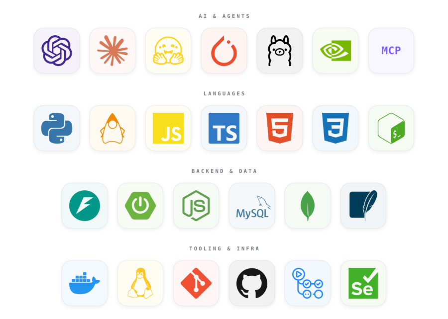

  <picture>
    <source media="(prefers-color-scheme: dark)" srcset="https://raw.githubusercontent.com/CaoLongyang/CaoLongyang/main/assets/hero-dark.svg">
    <source media="(prefers-color-scheme: light)" srcset="https://raw.githubusercontent.com/CaoLongyang/CaoLongyang/main/assets/hero-light.svg">
    
  </picture>

  

  
  
  

## About

I'm a computer science student at **Universiti Malaya**, and I build agents that touch real systems — a live Gmail inbox, a browser session, a university portal — rather than demos that stop at a chat window.

The model call is the easy part. What keeps pulling me back is everything around it: tokens that expire, pages that shift under you, a job that has to fire at 3am, and a human who needs to approve the last step without being annoyed by it.

## What I'm building

| Project | What it does | Built with |
| :--- | :--- | :--- |
| **[InboxPilot](https://github.com/CaoLongyang/inboxpilot)** | Reads a real Gmail inbox, decides which messages actually need action, waits for approval, then writes a verified draft. | `Python` `NVIDIA Nemotron` `Nebius` `Gmail API` |
| **[UM-Auto-Attendance](https://github.com/CaoLongyang/UM-Auto-Attendance)** | Watches for Universiti Malaya's unpredictable attendance windows, signs in on time, and stays out of the way otherwise — with a GUI, so it isn't a black box. | `Python` `Selenium` `scheduled tasks` |

More experiments in [my repositories](https://github.com/CaoLongyang?tab=repositories).

## Tech stack

  <picture>
    <source media="(prefers-color-scheme: dark)" srcset="https://raw.githubusercontent.com/CaoLongyang/CaoLongyang/main/assets/tech-stack-dark.svg">
    <source media="(prefers-color-scheme: light)" srcset="https://raw.githubusercontent.com/CaoLongyang/CaoLongyang/main/assets/tech-stack-light.svg">
    
  </picture>

## On GitHub

  <picture>
    <source media="(prefers-color-scheme: dark)" srcset="https://github-readme-stats-fast.vercel.app/api?username=CaoLongyang&show_icons=true&hide_border=true&include_all_commits=true&rank_icon=github&bg_color=00000000&title_color=8B7CFF&icon_color=38D9F5&text_color=C9D1D9">
    
  </picture>
  <picture>
    <source media="(prefers-color-scheme: dark)" srcset="https://github-readme-stats-fast.vercel.app/api/top-langs?username=CaoLongyang&layout=compact&hide_border=true&langs_count=8&bg_color=00000000&title_color=8B7CFF&text_color=C9D1D9">
    
  </picture>

  <picture>
    <source media="(prefers-color-scheme: dark)" srcset="https://raw.githubusercontent.com/CaoLongyang/CaoLongyang/output/snake-dark.svg">
    <source media="(prefers-color-scheme: light)" srcset="https://raw.githubusercontent.com/CaoLongyang/CaoLongyang/output/snake.svg">
    
  </picture>

## Contact

  
  

Kuala Lumpur, Malaysia · <a href="https://github.com/CaoLongyang">github.com/CaoLongyang</a>

