  <picture>
    <source media="(prefers-color-scheme: dark)" srcset="https://raw.githubusercontent.com/CaoLongyang/CaoLongyang/main/hero-dark.svg">
    <source media="(prefers-color-scheme: light)" srcset="https://raw.githubusercontent.com/CaoLongyang/CaoLongyang/main/hero-light.svg">
    
  </picture>

> I build agents that touch real systems — a live Gmail inbox, a browser, a university portal — rather than demos that stop at a chat window.

 

### Work

**[InboxPilot](https://github.com/CaoLongyang/inboxpilot)**  
Python · NVIDIA Nemotron · Nebius · Gmail API

Reads a real Gmail inbox, decides which messages actually need action, waits for approval, then writes a verified draft. The hard part was not the model call — it was keeping a human in the loop without making the flow tedious.

**[UM-Auto-Attendance](https://github.com/CaoLongyang/UM-Auto-Attendance)**  
Python · Selenium · scheduled tasks

Attendance at Universiti Malaya opens in unpredictable windows. This watches for them, signs in on time, and stays out of the way otherwise — with a GUI so it is not a black box.

**[MealWise](https://github.com/CaoLongyang/MealWise)**  
Python

A meal planning assistant built around a constraint I kept running into: deciding what to eat takes longer than cooking it.

 

### Open source

Pull requests I have opened against projects I actually use. Reading someone else's codebase until you can change one thing safely is the fastest way I know to learn.

| Project | Change |
| :--- | :--- |
| [alibaba/open-code-review](https://github.com/alibaba/open-code-review/pull/1888) `#1888` | Gate the scan `PLAN_TASK` pre-pass on file size, mirroring review's threshold |
| [trycua/cua](https://github.com/trycua/cua/pull/7107) `#7107` | Let callers set `browser_download`'s timeout instead of a hardcoded 30s |
| [topoteretes/cognee-community](https://github.com/topoteretes/cognee-community/pull/661) `#661` | New arXiv data-source connector, with pagination and rate limiting |
| [keyshade-xyz/keyshade](https://github.com/keyshade-xyz/keyshade/pull/1302) `#1302` | Stop generating slugs that begin with a hyphen |
| [sio2project/oioioi](https://github.com/sio2project/oioioi/pull/958) `#958` | Make django-debug-toolbar work in the Docker dev setup |
| [sherlock-project/sherlock](https://github.com/sherlock-project/sherlock/pull/3212) `#3212` | Move 8 sites from HTTP to HTTPS |
| [Dpro-at/Tel-Agent](https://github.com/Dpro-at/Tel-Agent/pull/272) `#272` `#273` | Simplified Chinese translations for the UI |

 

### Toolbox

**Languages** — Python · Java · JavaScript · SQL  
**AI** — PyTorch · LangChain · prompt and tool orchestration  
**Backend** — FastAPI · Spring · REST  
**Infra** — Docker · GitHub Actions · Linux

 

Kuala Lumpur, Malaysia · [github.com/CaoLongyang](https://github.com/CaoLongyang)
